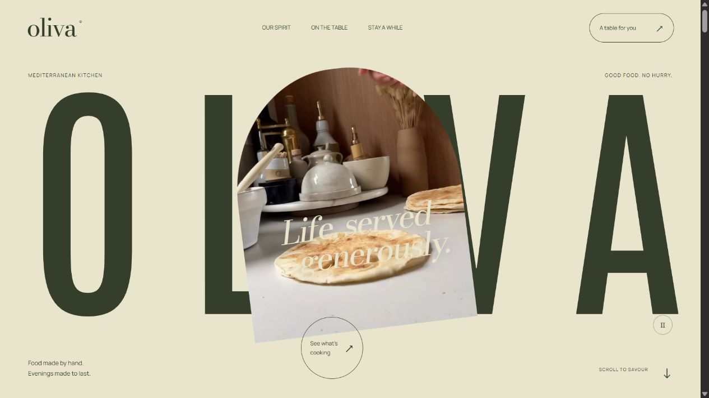
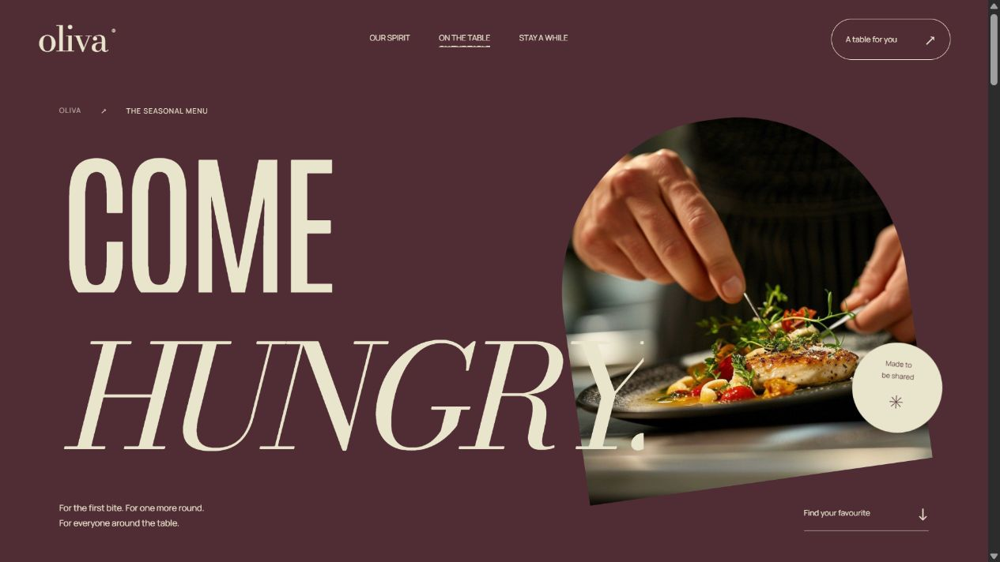

# OLIVA — Mediterranean Restaurant Website

A website for OLIVA, a made-up Mediterranean restaurant, built around scroll-driven animation. It's plain HTML, CSS and JavaScript. There's no framework, no animation library and nothing to `npm install`.

<p>
  
  
</p>

## Pages

| Route | What's there |
| --- | --- |
| `/` | Oversized letters around a tilted cooking video that grows to fill the screen as you scroll, a fanned-out photo collage, three featured dishes with wipe transitions, a circular video reveal and a horizontal gallery |
| `/our-spirit/` | The kitchen's philosophy, a pinned ingredient-to-table sequence and an olive-oil section |
| `/menu/` | A food video that expands on scroll, a category tracker, kitchen photos that change as you move through the dishes, the full seasonal menu and a print stylesheet |
| `/reservations/` | Booking form, opening hours and expandable FAQs |

## Highlights

- **Animation written from scratch.** Every scroll effect uses a small `requestAnimationFrame` loop that maps scroll position through easing helpers in [`motion-utils.js`](motion-utils.js). Pinned sections use CSS `position: sticky`, and the page scrolls normally the whole time.
- **Respects reduced motion.** With `prefers-reduced-motion`, the pages show a static layout: all three dishes appear in order and videos stay paused. Every background video also has its own play/pause button.
- **Booking form that runs in the browser.** It checks the date against opening hours (closed Mondays, dinner only Tuesday to Thursday), disables time slots that have passed, and lets you download a calendar file (`.ics`). Nothing is sent to a server.
- **Accessible.** The menu tabs work with the keyboard, the booking form, full menu and privacy notice open in native `<dialog>` elements, and the menu page has a print layout.
- **Page-transition curtain.** A short animation plays between pages without replacing normal browser navigation.
- **Pages generated at build time.** One shared shell plus a body template per page are put together by a small Node script, so the header, footer and booking form are written once.
- **Self-hosted media.** All photos, videos and fonts (Antonio, Bodoni Moda, Manrope, all under the OFL) are served locally.

## How it's built

```
├── index.html            # Homepage and the shared page shell
├── templates/            # Bodies for our-spirit, menu and reservations
├── render-pages.mjs      # Fills the shell with each template → <route>/index.html
├── menu-data.js          # Single source for dishes and prices
├── app.js                # Shared interactions: nav, tabs, dialogs, booking, curtain
├── home-motion.js        # Homepage scroll animation
├── pages.js              # Inner-page animation
├── menu-motion.js        # Menu-page animation and dish spotlights
├── motion-utils.js       # clamp / mix / ease / range helpers
├── style.css, pages.css
├── server.mjs            # Static server with video byte-range support
├── build.mjs             # Renders pages and copies everything into dist/
├── qa/check-site.mjs     # Checks the built pages: headings, duplicate IDs, links, anchors, assets
└── public/               # Images, video, fonts, favicon
```

To change a dish or price, edit [`menu-data.js`](menu-data.js). The menu tabs, the full menu and the menu page all read from it.

## Getting started

Requires **Node.js 20+**. There are no dependencies to install.

```bash
npm run dev
```

Then open [http://127.0.0.1:3000](http://127.0.0.1:3000). The dev server renders the pages when it starts. If you edit a template while it's running, rerun `node render-pages.mjs`.

| Script | Purpose |
| --- | --- |
| `npm run dev` / `npm start` | Render the pages and serve the project |
| `npm run build` | Produce the static site in `dist/` |
| `npm run preview` | Serve `dist/` |
| `npm run check` | Check the built site (run after `build`, with `preview` running) |

`dist/` is a plain static folder you can deploy to any static host.

## Notes

- OLIVA is not a real restaurant. The menu, prices and opening hours are sample content, and the booking form doesn't make real reservations.
- Grillify inspired the scale and scroll pacing. Qitchen and Nkora inspired the photographic mood. The branding, layout, copy and code are my own.
